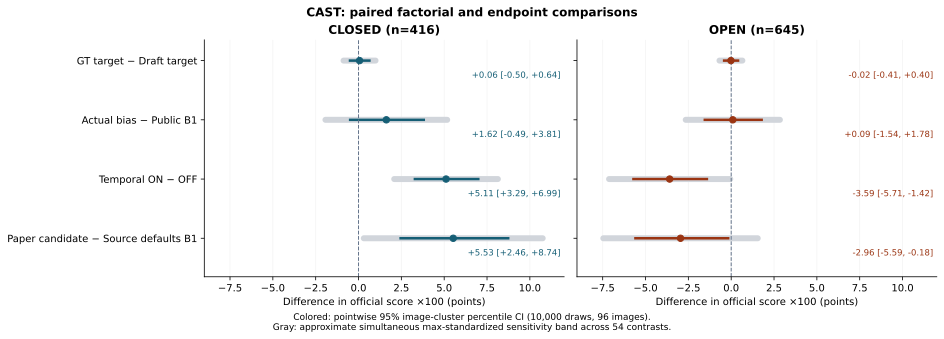
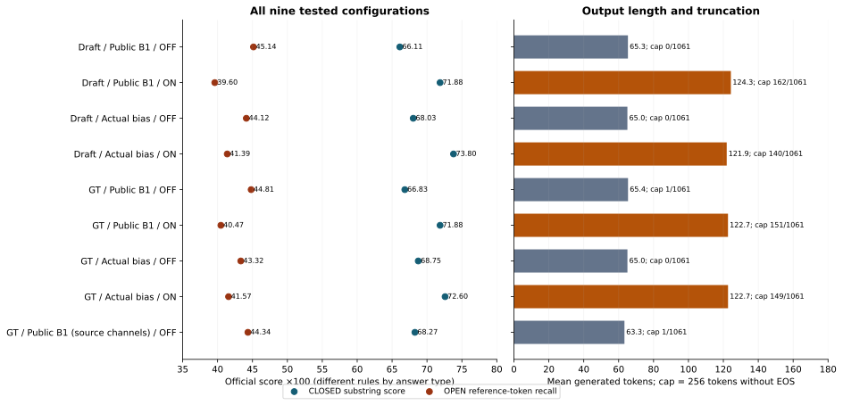

## CURRENT — 완료 판정 재검토: 수치 비교 완료, 추가 해석 검증 필요

2026-11-21 KST 사용자 재확인 요청에 따라 앞선 “제출 정리만 남았다”는 안내를 수정한다. **STEP80/81의 9조건 공식 점수와 통계 분석은 유효하게 완료됐지만, 전체 연구의 추가 검증이 없다고 단정할 수 없다.**

[완료 판정 재검토와 최소 추가 계획](COMPLETION_REAUDIT.md), [실제 위치 기록 근거](../evidence/completion_reaudit/evidence.json)를 우선 읽는다. 기존 STEP79의 Public B1 통제32출력 모두에서 기록된 weighted 위치와 실제 모델 source를 대입하면 conditional-alone short와 public batch long RoPE 구간 차이가 도출된다(실제 factor tensor를 새로 hook한 결과는 아님). 따라서 attention-bias 효과와 위치/RoPE/branch 효과의 세부 원인 분리는 아직 미완료다.

또한 현재 STEP80 CLOSED endpoint gain35/loss12의 실제 답변을 새로 lexical 감사하지 않았다. 과거 STEP73은 현재 출력과 다른 cohort이며 summary에 raw prediction/GT가 없다. 공식 지표 비교는 성립하지만 그 상승을 답변 의미 개선으로 해석하려면 최신 답변 검증이 필요하다.

다음: STEP82 CPU 산출물 감사 → 공통 위치/text-scope의 작은 GPU control → 동일성 확인 시 기존 Neutral/Temporal 재사용, 불일치 시 필요한 control만 추가 → M4/M5 해석 확정. 기존9조건의 전체 실험은 재실행하지 않는다. M3 완료는 유지하며 M4 표적 검증과 M5 최종 귀인은 보류한다. 아래 “M3–M5 모두 완료/필수 작업 없음”은 이전 수치 비교 범위의 기록이며 이번 항목으로 전체 완료 해석을 정정한다. 이번에는 새 GPU 제출 없음.

# CAST paper vs open source — 최종 9조건 성능 비교

작성 기준:2026-11-21 KST. STEP80 Job497286 전체1061문항·9조건·9549결과와 STEP81 paired 분석에 근거한다. **현재9조건의 공식 지표 수치 비교와 보고서 초안은 완료했다. 다만 재검토에서 위치/RoPE 분리 대조와 최신 CLOSED 답변 감사가 필요하다고 판단해 최종 귀인은 보류한다.** 아래 결론은 수리된 공개 기준선과 논문 지향 후보, 고정 SLAKE English test split, 시험한 설정에 한정한다.

## 1. 과제 질문에 대한 답

**어떤 요소 설정이 더 좋은가?**

- 관측 평균 기준 CLOSED 최고는 **Draft + actual bias + Temporal ON (73.7981)**, OPEN 최고는 **Draft + Public B1 + Temporal OFF (45.1401)**이다. 최고값 선택은 이 test set의 관측 비교이며 보편적 최적 설정이나 모든 인접 설정보다 확실히 우월하다는 주장이 아니다.
- 가장 일관된 변화는 Temporal이다. 나머지 요소를 균등 평균하면 CLOSED **+5.108점 [3.289,6.990]**, OPEN **−3.590점 [−5.706,−1.418]**이다. 따라서 answer type에 따른 상충 관계가 있다.
- GT/Draft의 최종 ROI는566/1061문항(53.35%)에서 달랐지만, GT target의 평균 성능 차이는 CLOSED+0.060점, OPEN−0.015점으로 CI가0을 포함한다. GT target이 일관되게 우수하다는 근거를 얻지 못했다. 이는 모든 개별 문항/조건에서 효과가 없다는 뜻이 아니다.
- actual bias의 평균 차이는 CLOSED+1.623점, OPEN+0.095점이며 둘 다 CI가0을 포함한다. 이 평가만으로 actual bias가 Public B1보다 일관되게 우수하다고 확정할 수 없다.

**논문과 공개 코드 중 어느 쪽이 더 좋은가?**

논문 지향 후보 Draft/bias/ON과 공개 기본 채널 endpoint GT/public_defaults_B1/OFF를 비교하면 CLOSED는 **+5.529점**, OPEN은 **−2.957점**이다. CLOSED에서는 후보가 높고, OPEN에서는 공개 기준선이 높은 관측 결과다. 단일한 전체 우열은 확정하지 않는다. 두 점수 규칙을 혼합한 가중 평균 차이는+0.370점, cluster CI[−1.836,+2.647]로0을 포함하며 accuracy로 부를 수 없다.

이 답은 **수리된 Public B1 vs 작성한 paper-aligned candidate**의 비교다. 공개 원형 B0는 알려진 padding guard 실패로 점수가 없고, 비공개 저자 Temporal 구현의 동일성도 입증하지 않았다. 수정 없는 저자 코드 재현이나 논문 숫자 재현 성공으로 표현하지 않는다.

## 2. 실험과 검증 범위

- 모델/LoRA/processor/source·체크포인트 식별자 고정, BF16/실제 FA2, 동일 캐시 후보, K16, blur/mean·동일 선택 수식/후처리.
- Draft 선택은 native greedy32, native EOS2; GT target과 분리. 최종 답변은256/EOS32000. Temporal은 current base−0.5previous base, t0=current base.
- 기본8셀은 bbox0/highlights[]/foreground1을 공통 통제한다. 추가1셀은 공개 dataset bbox/object/highlight/mask-value 및 가능한 GT-answer fallback 채널을 별도로 보존한다.
- Public B1은 padding guard 한 곳만 수리한다. 양수 mask는 native FA2에서 버려지지만 weighted-cumsum 위치 계산은 유지된다. 실제 bias는 일반 위치와 text weight1 및 attention-score 조정을 사용한다. Spatial 비교는 이 **전체 처리 경로 차이**이며 bias 한 연산의 순수 인과 효과가 아니다.
- 4worker GPU_PASS,1061/1061완료,9549결과. 사용자 서버 verify 출력은 Slurm4작업 COMPLETED0:0이다. 요약 ZIP의 CRC/계획/paired 데이터/6개 실행 소스 SHA와4worker 기록을 로컬에서 독립 확인했다.
- 요약 ZIP에는 원본9549예측·private GT·문항별 완료 영수증이 없다. 따라서 여기서 재계산한 것은 **저장된 문항별 점수의 평균/대비**다. 원본 예측 재채점과 모든 sample receipt의 독립 검증을 했다고 주장하지 않는다. 해당 검사는 서버 verify가 수행했고 원본은 Ariel에 보존된다.

## 3. 전체 9조건 결과

CLOSED416문항의 지표는 GT substring 포함 판정, OPEN645문항은 정답 token-set recall이다. OPEN은 F1이 아니며 긴 설명에 정답 단어가 포함돼 점수를 얻을 수 있다.

| ROI target | Spatial | Temporal | CLOSED ×100 | OPEN ×100 | Mean tokens | No-EOS cap /1061 |
|---|---|---|---:|---:|---:|---:|
| Draft | public_B1 | OFF | 66.1058 | 45.1401 | 65.32 | 0 |
| Draft | public_B1 | ON | 71.8750 | 39.6000 | 124.31 | 162 |
| Draft | bias | OFF | 68.0288 | 44.1187 | 65.02 | 0 |
| Draft | bias | ON | 73.7981 | 41.3870 | 121.93 | 140 |
| GT | public_B1 | OFF | 66.8269 | 44.8119 | 65.37 | 1 |
| GT | public_B1 | ON | 71.8750 | 40.4738 | 122.66 | 151 |
| GT | bias | OFF | 68.7500 | 43.3247 | 65.04 | 0 |
| GT | bias | ON | 72.5962 | 41.5737 | 122.68 | 149 |
| GT | public_defaults_B1 | OFF | 68.2692 | 44.3442 | 63.32 | 1 |

## 4. 문항별 paired 비교와 불확실성

96개 이미지 SHA를 cluster로10,000회 복원추출(seed20261121)했다. 한 이미지의 모든 질문과9조건을 함께 뽑고, 각 replicate에서 질문 수로 나눈 평균을 계산했다. 아래95% CI는 image-cluster percentile CI이며 **각 비교의 pointwise 구간**이다.

| 비교 | CLOSED 차이 | 95% CI | OPEN 차이 | 95% CI |
|---|---:|---|---:|---|
| GT−Draft (다른 두 요소 균등 평균) | +0.060 | -0.498 to +0.635 | -0.015 | -0.413 to +0.399 |
| Bias−Public B1 (다른 두 요소 균등 평균) | +1.623 | -0.489 to +3.808 | +0.095 | -1.540 to +1.778 |
| Temporal ON−OFF (다른 두 요소 균등 평균) | +5.108 | +3.289 to +6.990 | -3.590 | -5.706 to -1.418 |
| 논문 지향−공개 기본 endpoint | +5.529 | +2.457 to +8.736 | -2.957 | -5.589 to -0.176 |
| 공개 annotation 채널−공통 통제 채널 | +1.442 | -0.752 to +3.597 | -0.468 | -2.157 to +1.226 |

54개 CLOSED/OPEN 대비를 동시에 살펴본 영향을 확인하기 위해 고정 bootstrap SE의 max-standardized 근사 동시 band도 계산했다. 이는 정확한 FWER 보장이 아니다. 이 민감도 band에서 endpoint CLOSED 차이는[+0.309,+10.748]로 양수지만 OPEN 차이는[−7.463,+1.549]로0을 포함한다. OPEN의 감소 관측과 pointwise CI를 다중 비교 전반의 확정적 유의성으로 확대하지 않는다. 모든 단순 효과·상호작용·평균 효과 및 두 구간은 contrasts.csv와 analysis.json에 있다.

동일 ROI495문항에서는 네 대응 조건 모두 GT/Draft 예측 해시가 같았다. ROI가 달랐던566문항은 CLOSED210/OPEN356이다. GT−Draft의 조건별 효과 방향과 ROI×Temporal 상호작용도 서로 달라, ROI target의 전체 평균만으로 세부 효과를 지우지 않는다. 마스크 차이로 나눈 subgroup은 출력 이후 정해진 기술적 집단이므로 새로운 무작위 표본/인과 비교로 해석하지 않는다.

## 5. 출력 길이와 지표 해석

Temporal OFF의 평균 길이는 대체로65토큰, ON은122–124토큰이다. Temporal ON 네 셀의256토큰/no-EOS 출력은 각각162,140,151,149개이며 OFF 네 셀은0,0,1,0개다. 공개 기본 endpoint는1개다. 길이 변화는 관측 사실이며 점수 변화의 원인이라고 단독 확정하지 않는다.

기존 STEP73에서 CLOSED substring이 normal/innominate 같은 문맥에서도 GT No를 포함해 통과하는 사례를 확인했다. 새 전체 요약에는 raw prediction이 없으므로 그 결함이 STEP80 개선분의 몇 퍼센트를 설명하는지는 계산하지 않았다. 공식 점수 상승을 의미적 정답성이나 환각 감소로 바꾸지 않는다. 기존 알려진 원본 주석 문제도 수정/재라벨링하지 않았다.

## 6. 최종 판단과 적용 범위

합의한 비교 범위에서는 **CLOSED 지표를 중시하면 Temporal ON 후보가 유리하고, OPEN 지표에서는 Temporal OFF가 유리한 경향**이 확인됐다. ROI target이나 actual bias의 일괄 우월성은 확인되지 않았다. 공개 기본 endpoint 대비 논문 지향 후보의 결과도 CLOSED 개선/OPEN 저하로 갈리므로 한쪽이 전반적으로 더 좋다고 보고하지 않는다.

M3 전체 실행과 기존 M4 수치 분석은 완료했다. 재검토 후 M4에 작은 위치/RoPE control 및 CPU 답변 감사를 추가했으며 M5는 그 결과를 반영한 뒤 확정한다. 기존9조건을 통째로 재실행하지 않는다. 의미적·임상적 평가, 다른 데이터/모델로의 일반화, 미공개 저자 구현/원형 B0 숫자 재현, Temporal 가중치 탐색은 별도 확장 과제다. 이를 본 실험으로 완료했다고 주장하지 않는다.

## 7. 재현 및 인수인계

- STEP80 plan SHA: e73250456c8de9cd37dba05ce67ff3e70ea8761d706de23344bf950c773b6818.
- 입력 요약 ZIP: step80-comparison-summary-497286.zip, SHA62c23c5438955c7146fb97a549dd58ce6d74786db549e6509d17ab36a9cdd86a.
- paired metrics SHA:68d97340ec368caefefd92c53ffa548d9767926d8f15f225110b3f60c1af93e2.
- 분석: analyze.py, write_report.py, analysis.json, contrasts.csv, case_scores_lengths.csv, independent_summary_review.json 및 SVG/PNG/PDF 그림.
- GitHub에는 검증된 실행6소스, STEP81 분석 소스와 결과, 최신 MASTER_PLAN/CONTINUATION/EXPERIMENT_LOG를 보존한다. checkpoint/data/private GT/9549원본 출력은 Ariel 보존 경로를 따른다.
- 새 채팅에서는 docs/COMPARISON_FINAL_REPORT.md와 docs/CONTINUATION.md를 우선 읽는다. STEP79/80을 기본 다음 작업으로 재실행하지 않는다.
